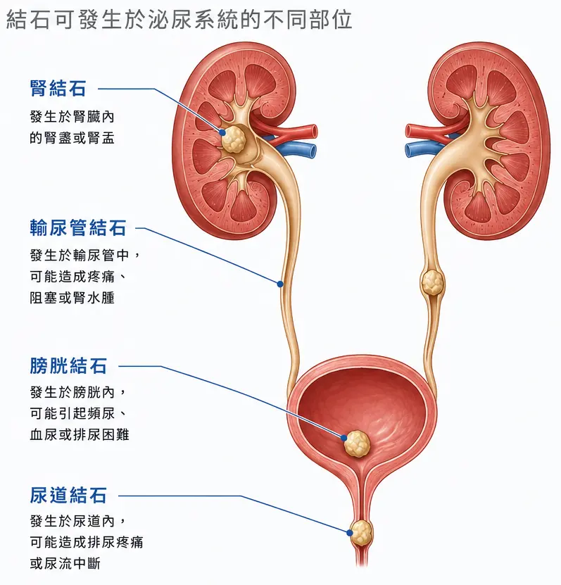

## 30 秒看重點

- 尿路結石是尿液中的礦物質結晶、聚集後變大的硬塊。
- 在台灣很常見，而且容易再次發生。
- 突然的腰痛、血尿、發燒，請盡快就醫。
- 預防從喝水、飲食與定期追蹤開始。
- 不同成分的結石，預防的重點也不同。

## 什麼是尿路結石？

尿路結石，又稱泌尿道結石，是泌尿系統內出現的硬塊。

泌尿系統由腎臟、輸尿管、膀胱與尿道組成。
腎臟製造尿液，經輸尿管送到膀胱儲存，最後由尿道排出。

尿液裡本來就含有各種礦物質與鹽類。
當它們濃度太高，或尿液性質改變，就可能結晶、聚集，慢慢變大成結石。

結石可能出現在尿路的任何位置：

- **腎結石：** 位於腎臟，最常見。
- **輸尿管結石：** 多半是腎結石往下掉所造成。
- **膀胱結石：** 位於膀胱。
- **尿道結石：** 位於尿道，較少見。

## 台灣的概況

尿路結石是台灣常見的泌尿道疾病！
院所衛教資料指出，台灣盛行率約 10%，男性約為女性的 2 倍，好發於 30–50 歲，近年有發生年齡提早的趨勢。[^1]

結石也很容易再次發生！
台灣院所資料指出，病患一年內復發率約 10-30%，五年內可達 50-60%。[^2]
所以結石排出或手術之後，長期預防與追蹤同樣重要。

## 結石為什麼會形成？

結石是多種因素累積的結果，不能歸因於單一因素造成。

- **水分不足：** 喝水少或大量流汗，尿液會變濃，礦物質更容易結晶。[^3]
- **飲食型態：** 動物性蛋白質、鹽分或高嘌呤食物（如部分肉類、海鮮）吃得多。[^3]
- **生活習慣：** 久坐少動、體重過重。有資料指出，結石發生率與 BMI 呈正相關。[^4]
- **環境與季節：** 高溫環境或夏季流汗多，若水分補充不足，尿液容易濃縮。[^2]
- **個人與家族因素：** 曾經得過結石、有家族史，或有其他泌尿道、代謝相關疾病的人，請與醫師討論自己的風險。

### 結石也有不同種類，不是每個結石都一樣

依成分不同，結石可分為含鈣結石、尿酸結石、感染性結石、胱胺酸結石等。
成分不同，預防的重點也不同。
所以取出或排出結石後，建議請醫師做成分分析。

## 常見症狀

症狀會因結石的大小與位置而不同。
有些人在 結石移動 或 造成阻塞 之前，幾乎沒有感覺。

- **突發性劇痛（腎絞痛）：** 常從腰側開始，可能延伸到下腹、鼠蹊部，甚至外生殖器。疼痛劇烈時，患者常痛到無法平躺。[^5]
- **血尿：** 尿液可能呈粉紅、紅色或茶色。[^5]
- **頻尿、尿急、排尿不適：** 結石靠近膀胱或尿道時，容易出現這類症狀。[^5]
- **噁心、嘔吐、腹脹：** 疼痛也可能引起腸胃不適。[^5]

### 需要立即就醫的警訊

出現下列任何一項，請盡快到急診或泌尿科：[^3]

- 腰部或腹部劇烈疼痛，吃止痛藥也沒有改善。
- 發燒、畏寒。
- 尿量明顯減少。
- 持續嚴重的血尿。

結石如果阻塞尿路又合併感染，可能傷害腎臟，不要拖。

## 如何確認是不是結石？

醫師會先問診，再安排尿液檢查與影像檢查（如超音波、X 光或電腦斷層）。
目的是確認結石的大小、位置，以及有沒有造成阻塞。
實際的檢查項目與治療方式，請以醫師評估為準。

## 每天可以做的預防

1. **每天補充水分：** 以白開水為主。歐洲泌尿科醫學會（EAU）建議每日飲水約 2.5-3.0 公升，讓 24 小時尿量超過 2.5 公升。[^6] 台灣院所的衛教，多數建議每日至少 2,000 毫升，並依體重、活動量與天氣調整。[^1][^7] 腎功能不佳或有飲水限制的人，請依醫師指示。
2. **看尿液顏色：** 透明到淡黃色，通常表示水分足夠。[^1]
3. **分次喝水：** 不要一次猛灌，整天平均補充。[^7]
4. **少鹽、均衡飲食：** EAU 建議每日鹽（NaCl）攝取不超過 4-5 公克，[^6] 並留意動物性蛋白質的攝取量。[^8]
5. **避免憋尿：** 有尿意時，就去上廁所。[^9]
6. **規律運動、維持體重。**
7. **定期追蹤：** 依醫囑回診，必要時檢查結石成分與尿液代謝狀況。

## 常見問答

**Q1: 結石排出後，就不會再發生了嗎？**
不一定。結石的復發率不低，需要持續調整飲水與飲食習慣，並依醫囑追蹤。[^2][^5]

**Q2: 沒有症狀，需要檢查嗎？**
有些結石完全沒有症狀。若有家族史、曾經得過結石，或出現血尿、腰痛，建議諮詢泌尿科醫師。

**Q3: 喝越多水越好嗎？**
不是。飲水要適量。特別是腎功能不佳者，更要依醫囑。若出現尿液過淡、頭痛、噁心、水腫或喘等情形，可能是水分過量，請就醫諮詢。[^7]

## 參考資料

[^1]: [台北榮總營養部：尿路結石衛教](https://www.vghtpe.gov.tw/nutr/Fpage.action?muid=13563&fid=12567)

[^2]: [永和耕莘醫院：尿路結石夏季最易復發](https://www.cthyh.org.tw/?aid=304&pid=0&page_name=detail&iid=239)

[^3]: [南門醫院：泌尿道結石注意事項](https://www.nanmen.org.tw/?aid=509&pid=0&page_name=detail&iid=150)

[^4]: [台灣癌症防治網：泌尿道結石的成因及處理](http://web.tccf.org.tw/lib/addon.php?act=post&id=4906)

[^5]: [台大醫院：尿路結石的認識與防治](https://health.ntuh.gov.tw/health/new/6589.html)

[^6]: [EAU Guidelines on Urolithiasis: Metabolic Evaluation and Recurrence Prevention](https://uroweb.org/guidelines/urolithiasis/chapter/metabolic-evaluation-and-recurrence-prevention)

[^7]: [衛福部新營醫院：我有泌尿道結石我要如何喝水呢？](https://www.syh.mohw.gov.tw/?aid=626&pid=112&page_name=detail&iid=434)

[^8]: [羅東博愛醫院：尿路結石預防飲水量相當重要](https://www.pohai.org.tw/health_detail.php?PKey=1666)

[^9]: [東元醫院：認識尿路結石和一般預防原則](https://www.tyh.com.tw/Urology/health10.html)
